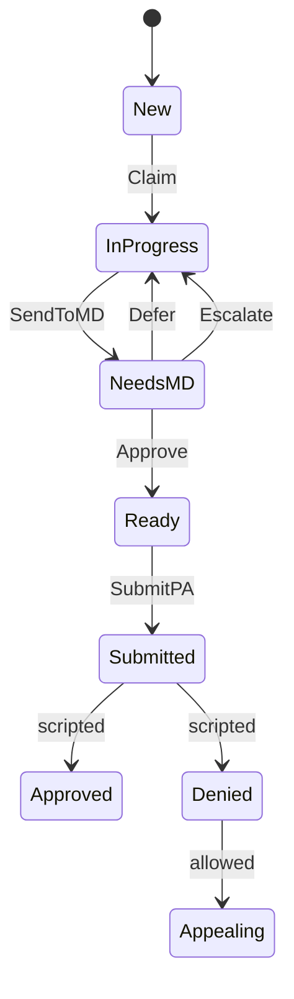

# CareSummarizer product audit

Language, components, design thinking, and where the product should show more than it tells.

CareSummarizer is a clickable prior-authorization front end (Next.js 16, React 19, built in v0 and deployed on Vercel). There is no API, no model call, no login, and no save. Refreshing the page rebuilds the queue from generators, so IDs and assignments change. Every "AI", "sync", and "submit" is local state or a fixed sentence.

The product name in the page title is **CareSummarizer**. The assistant inside a case is **CareLens**. The role switcher says **Case Manager**.

## What the product is trying to say

The user-story doc ([USER-FLOWS.md](USER-FLOWS.md)) and the welcome screen want one voice: the tool gives time back, the person decides, CareLens explains itself. [lib/design-system.ts](../lib/design-system.ts) locks four type styles and one color per status. [lib/types.ts](../lib/types.ts) locks the data words.

Two voices are already in the UI.

- **Operations voice** on the queue, the audit table, and the workflow bar: Claim, Needs MD, Ready, Submit PA, denial risk, policy gap, progress percent.
- **Patient-impact voice** on the welcome screen, notifications, and dashboard: "Treatment Authorized", "Patient Waiting", "Patients Helped Today", "Sarah Johnson can now get her MRI".

The same event is "PA approved" in the data, "Treatment Authorized" in a notification, and "Approved" on a badge.

## Words the code actually owns

### Brand and roles

CareLens changes title by role in [components/care-lens-drawer.tsx](../components/care-lens-drawer.tsx):

- "CareLens Coach" for the case manager (chat on)
- "Clinical Review" for the physician (read-only)
- "Compliance Report" for the auditor (export)

Roles in [lib/types.ts](../lib/types.ts) are `case_manager`, `physician`, and `auditor`, shown as CM, MD, and AU. The signed-in people are fixed: Maria Santos, Dr. Robert Kim, Jennifer Walsh. The case manager view is the one case layout. The story doc never says nurse.

### Case status

The words on the badge come from `statusConfig` in [lib/workflow-utils.ts](../lib/workflow-utils.ts), copied again as `statusLabels` in [lib/design-system.ts](../lib/design-system.ts):

- `new` → New
- `in_progress` → In Progress
- `needs_physician` → Needs MD
- `ready` → Ready
- `submitted` → Submitted
- `approved` → Approved
- `denied` → Denied
- `appealing` → Appealing

**Escalated** is a real status. `physicianEscalate` in [lib/app-context.tsx](../lib/app-context.tsx) sets the case to escalated, and Medical Director reads those cases from the patient store. **Signed off** is the label for `ready`, and that status is computed from payer rules in `requirementsMet`, not assigned by rotation.

**Urgency**, separate from status: STAT, URGENT, ROUTINE.

### Clinical objects

On a patient: problem list with ICD codes, payer rules (`satisfied`, `missing`, `unclear`), alerts, timeline, medications, course, and optional social needs, a PA deadline, and concurrent editors. Those last three are filled on stress-test patients and drawn on no screen.

### CareLens objects

This is the AI language.

- Confidence: High, Medium, Low, plus a percent invented only in the drawer (High becomes about 90).
- Three breakdown labels: Evidence completeness, Policy alignment, Clinical clarity.
- Denial risk: High, Medium, Low.
- A risk is open, addressed, or not applicable. The buttons say "Why is this flagged?", "Addressed", and "Dismiss".
- A policy gap is open, resolved, or in progress.
- A recommendation is pending, in progress, completed, or dismissed. Its action types are request consult, add documentation, order a test, schedule follow-up, send a message, or review the case.
- The percent on the workflow bar is a weighted score: rules 40, gaps 30, risks 20, recommendations 10. It is not "percent of the form" and it is not confidence. The bar never says what the number is.
- The Ready badge is assigned by rotating demo statuses in `generateWorkflow`. A separate flag, `readyForPA`, means all rules are met, no high risk is still open, and confidence is High. A case can say Ready while CareLens still lists open gaps.

### Chat

Chat is a keyword script. Questions with "risk", "confidence", or "override" get a template that invents numbers ("73% denial probability", "historical approval rate 72%"). Buttons such as "Send to cardiology" and "Apply winning pattern" only add more chat text. They do not run the action.

### Audit

Audit rows are free-text sentences ("Case claimed", "Risk factor addressed: …"). There is no fixed verb list, so the audit screen cannot group them.

### Status machine as the code runs it

The story says Needs MD goes to Escalated and then to the medical director. The code sends it back to In Progress, and Medical Director is a separate mock page.

## Components and how each one uses the language

### Shell

- [app/layout.tsx](../app/layout.tsx) sets the title "CareSummarizer" and the description "utilization review and prior authorization". Fonts are Plus Jakarta for the UI, JetBrains Mono for section labels, and Fraunces, which the case manager screens do not use.
- [components/app-header.tsx](../components/app-header.tsx) is the live nav: Queue, Dashboard, MD Review (physician only), Appeals (case manager only), Audit (auditor only). The role switcher is the only login. Search says Ctrl+K and opens nothing.
- [components/app-sidebar.tsx](../components/app-sidebar.tsx) is not on screen. It names a second product: Patient List, Ops Dashboard, Integration Management, Quality & Compliance, Training & Support, Settings. Those routes exist. The header never links to them.
- [components/role-aware-layout.tsx](../components/role-aware-layout.tsx) swaps the whole tree by role. On the home page and on a patient URL, physician and auditor never see the case-manager workspace.
- [components/theme-provider.tsx](../components/theme-provider.tsx) and [components/system-status.tsx](../components/system-status.tsx) are not mounted. System status would say Connected, Syncing, or Offline, with no backend.
- [components/keyboard-shortcuts-dialog.tsx](../components/keyboard-shortcuts-dialog.tsx) is mounted on every page.

### State, the only backend

- [lib/app-context.tsx](../lib/app-context.tsx) holds the queue, the role, and the verbs: claim, send to physician, approve, defer, escalate, submit. Regenerating the summary and requesting documentation only write to the console. A "consult request" waits one second and returns "Consult request has been submitted" without creating a consult, a note, or an order. Permissions live in `ROLE_PERMISSIONS`. A second checker, `canPerformAction`, can drift from that list.
- [lib/patient-data.ts](../lib/patient-data.ts) generates cohorts: surgery infection, heart failure, COPD, psych, and obstetrics, each in fresh, halfway, and clean states. CareLens lines are written as if an analyst wrote them.
- [lib/edge-case-patients.ts](../lib/edge-case-patients.ts) is the spec for hard days: sparse chart, too many notes, insurance limbo, no published policy, conflicting notes, a status that flipped, 50% confidence, an override, a stale authorization, a clean case, social needs blocking discharge, two people editing, a weekend deadline, an appeal reopen, and documents in Mandarin. The screens do not branch on which kind of case it is.

### The daily line of work

- Home, for the case manager ([app/page.tsx](../app/page.tsx)), is a welcome essay plus "Select a patient". The stats (4.2 hours, 12 cases, 1.8 minutes) are constants.
- [components/patient-list-panel.tsx](../components/patient-list-panel.tsx) filters by urgency and by the eight statuses. Search matches name or MRN in memory.
- [app/patient/[id]/page.tsx](../app/patient/[id]/page.tsx) has tabs: Summary, Prior Auth, Evidence, Appeals, Team. The CareLens button reads "Open CareLens", "View Analysis", or "Analysis Report" by role. Physician and auditor on that URL still get their own layouts, so they do not see those tabs.
- [components/clinical-summary-view.tsx](../components/clinical-summary-view.tsx) sections are PROBLEM LIST, PAYER REQUIREMENTS, and AI CLINICAL SUMMARY. Toasts say "Documentation Requested", "Case Claimed", and "PA Submitted". The sheet title is "Get Clinical Sign-Off"; the button is "Send to Physician".
- [components/workflow-bar.tsx](../components/workflow-bar.tsx) is the verb strip: Claim Case, Generate PA, Awaiting MD, Submit PA, Send to MD. It compares the assignee to the user object, so "assigned to you" does not match the name.
- [components/patient-object-card.tsx](../components/patient-object-card.tsx) is the identity strip: name, MRN, room, insurance, urgency, length of stay, document count, denial risk, confidence, primary ICD.
- [components/care-lens-drawer.tsx](../components/care-lens-drawer.tsx) owns almost all AI wording: confidence, risks, policy, recommendations, chat.
- [components/physician-approval-modal.tsx](../components/physician-approval-modal.tsx): Approve moves the case to Ready, which means ready to submit, not approved by the payer.
- [components/physician/physician-layout.tsx](../components/physician/physician-layout.tsx) is its own stack and does not reuse the summary.
- [components/auditor/auditor-layout.tsx](../components/auditor/auditor-layout.tsx) is a counts strip and a table, not a case file.
- [components/prior-auth-composer.tsx](../components/prior-auth-composer.tsx), [components/evidence-panel.tsx](../components/evidence-panel.tsx), [components/appeals-panel.tsx](../components/appeals-panel.tsx), and [components/collaboration-panel.tsx](../components/collaboration-panel.tsx) are tab bodies. Team uses "Case Handoff". The appeals tab and the Appeals page are separate.
- [components/notification-center.tsx](../components/notification-center.tsx) is a fixed list. "Advocacy Call Scheduled" has no object in the workflow. Links go to `/prior-auth` and `/medical-director`, not to the case that changed.

### Screens off the daily path

- [app/dashboard/page.tsx](../app/dashboard/page.tsx), "Your Impact Today", uses a second component set (Redwood scorecards). Its patient stories are not the queue.
- [app/medical-director/page.tsx](../app/medical-director/page.tsx) has its own mock queue. Its approve, deny, and consult buttons do not call the workflow.
- [app/audit/page.tsx](../app/audit/page.tsx) uses live status counts, then shows average processing as the constant "2.4 days". The subtitle "claim to submission" collides with the verb Claim.
- [app/appeals/page.tsx](../app/appeals/page.tsx), [app/evidence/page.tsx](../app/evidence/page.tsx), and [app/prior-auth/page.tsx](../app/prior-auth/page.tsx) are full-page twins of the patient tabs, with their own copy and data.
- [app/integrations/page.tsx](../app/integrations/page.tsx) names Epic, Availity, Cerner, Surescripts, and Change Healthcare, with Synced, Partial, Failed, and Offline. Nothing syncs. It is not in the header.
- [app/compliance/page.tsx](../app/compliance/page.tsx) shows "98.5%" and is a different page from Audit.
- [app/training/page.tsx](../app/training/page.tsx) says "CareSummarizer". The cards do not open anything.
- [app/settings/page.tsx](../app/settings/page.tsx) shows Dr. Emily Rodriguez, Case Manager. Save does not change the signed-in user.
- [app/calibration/page.tsx](../app/calibration/page.tsx) and [components/ai-calibration-test-sheet.tsx](../components/ai-calibration-test-sheet.tsx) are an internal test sheet, "UM Dashboard AI Calibration Test Sheet", with a second status vocabulary: PENDING_REVIEW, IN_REVIEW, MORE_INFO_NEEDED. Those are not case statuses.
- [components/ai-progress.tsx](../components/ai-progress.tsx) is not mounted. It would cycle "Extracting clinical data → Analyzing documentation → Validating against policy → Generating summary" on a timer.
- [components/redwood/index.tsx](../components/redwood/index.tsx) (page header, scorecard, gauge, timeline, status badge) is the dashboard's design system. The case workspace uses [lib/design-system.ts](../lib/design-system.ts). Two badge components, two color maps.

### UI kit

Actually used: button, badge, card, dialog, dropdown, sheet, tabs, textarea, input, label, tooltip, avatar, collapsible, popover, scroll area, select, progress, and toast.

Installed and unused: recharts, zod, react-hook-form, sonner, cmdk, and most of the other Radix packages. Toast logic is copied in both [hooks/use-toast.ts](../hooks/use-toast.ts) and [components/ui/use-toast.ts](../components/ui/use-toast.ts).

## Design thinking already in the product

The case workspace was designed as an instrument for someone handling many cases. The pages around it were designed as a pitch.

- **Glance, not drill.** The design file says this is for 20–40 cases a day. The patient card is three rows, and the comment in the file says all of it is visible with no hover. Hiding the MRN is an eye toggle on the card.
- **Color is the word.** One palette for STAT, Needs MD, Ready, missing, and satisfied. A sentence that repeats the color is extra.
- **Four type styles.** Label, body, title, section overline. Physician review breaks this with raw 9px, 11px, and 12px type and an italic serif name. Case manager and physician look like two products.
- **Show less until it matters.** Unmet payer rules sort to the top and start open. CareLens is a drawer you choose to open. Risks, gaps, and recommendations collapse. Chat is the last layer.
- **The next verb sits on the work.** Status, a bar, an issue count, "N Missing", and one button: Claim, Send to MD, Generate PA, Submit, or a disabled Awaiting MD.
- **The physician sees one case.** "1 of N", the name, the complaint, only high risks, only missing or unclear rules, notes, and Approve / Defer / Escalate pinned at the bottom. An empty inbox is a check mark and "No cases awaiting review".
- **The auditor reads a table.** Counts, status chips, and a trail number that opens a sheet. The trail itself is still sentences.
- **System status was specified and not built.** Comments in the code cite visibility of status and a way to recover from errors. Those components are not on screen. There is no undo after Claim, Dismiss, or Approve.
- **Explainable AI was specified as checks, then written as prose.** The confidence row is a bar, a met count, and a check list. The sentences under it, and the chat reply, repeat that list and add numbers the checks do not have.

The data is ready for marks the screens do not draw: a deadline clock (`on_track`, `at_risk`, `overdue`), a second editor as avatars, social needs as a blocking chip, conflicting notes as two quotes side by side, and the next person who has the case shown on the bar. Home, the dashboard, and notifications tell those stories instead.

## Show more than tell

If a count, a color, a check, or the next button is already there, the sentence beside it is telling. If a sentence describes something with no mark on the screen, the mark is what is missing.

### Already showing

Keep these, and make them true.

- Queue row: urgency, status, progress percent, assignee or "Awaiting assignment".
- Patient card: room, length of stay, documents, denial risk, confidence, ICD.
- Payer row: tint and icon for satisfied, missing, or unclear, a "3/5 met" count, and after Request a Requested chip. The toast "Documentation Requested" repeats the chip.
- Workflow bar: one primary verb. "Awaiting MD" is the next person made visible.
- Physician blockers: a left border, the gap, and a small Missing or Unclear.
- CareLens tiles: Confidence, Denial risk, Rules met. The paragraph above them says the same thing.
- Integration traffic lights are the right shape, sitting on fake data.

### Telling, and the mark that should replace it

- Home essays ("We know the reality", "Our promise", three slogan cards) become the queue's own counts: STAT due today, yours, waiting on a physician. The swipe tip exists because the list has no visible handle.
- Dashboard captions that restate 127, and stories such as "Sarah Johnson can now get her MRI", become gauges fed by the live queue.
- "Patient waiting… due in 2 hours" becomes a deadline chip on that card.
- "Click each score to see contributing factors" is an instruction. The chevron already says that. The check rows are hardcoded, mostly always true, and should be the same payer rules as the summary.
- "Why is this flagged?" should open the evidence links and the rule row. Chat is for a question the card cannot show.
- Full risk paragraphs under every open risk collapse to the factor name and severity. The policy citation opens on demand.
- "Case approved. Proceed to next case." The stack can advance on its own. The status already changed.
- Defer and Escalate have notes marked optional. The story says a reason is required. The reason is what enables the button.
- Audit sentences become a status timeline, New through Ready, with the person and time on each step.
- The unmounted AI-progress labels describe work the system is not doing. A real run shows which documents and which rules changed.
- Training, compliance, and settings describe the product. They stay off the daily header until they show a real setting or a real score.
- An `EmptyState` component exists and is unused. Home lectures. The physician inbox and the auditor filter state the result.

The place to show more than tell is the strip the person already looks at: queue row, patient card, workflow bar, payer checks, physician blockers. A hero, a toast, a chat reply, or a dashboard story either becomes a mark on that strip or leaves.

## What has to be true for longer daily use

The prototype can demo a morning's queue. It becomes the system of work when the words and the records are the same object.

1. **One glossary and one status machine.** Escalated is a real status, or the product stops saying it. Medical Director reads the patient store. Approved means the payer decided. Physician sign-off stays Ready, or gets its own label such as Signed off.
2. **One case page for every role.** Permissions turn actions off. Physician and auditor see Summary, Evidence, and CareLens.
3. **Persistence and identity.** Real users, no role switcher, an audit log that survives reload. Social security numbers and full clinical text do not live only in the browser.
4. **CareLens returns a structure.** Confidence, factors, citations, and gaps. Chat may only cite fields on that case. An override writes the audit row the auditor reads.
5. **Actions change the case.** Requesting a consult creates an alert. Resolving a risk requires a note. Submitting stores a confirmation number. A payer decision moves Submitted to Approved or Denied.
6. **Hard-day fields are on the strip.** Deadline, social needs, conflicting notes, a sparse chart, a second editor.
7. **One of each orphan.** Header or sidebar. Patient tabs or the twin pages. One badge system. Calibration aliases, the fake progress animation, and the unmounted status banner are either wired or removed.
8. **Empty, error, and conflict states.** No cases, a failed sync, two people in the same section.
9. **One visual system.** Physician review uses the same type scale, status colors, and patient card. The serif face stays only if the patient name is the one glance target.
10. **Show on the strip.** Home and dashboard read live counts. CareLens factors are the case's own rules. A toast does not repeat a chip that just changed. Chat does not restate a check list.

## How to check it, in order

1. Say a status on the queue, the workflow bar, the audit stat, and the notification. They should be the same word. Ready, Approved, and "Treatment Authorized" are three events today.
2. Escalate as the physician. The badge says Escalated, and that case appears on Escalations.
3. Ask CareLens why the score is what it is. The reply invents a percent and a historical approval rate.
4. Click "Request Cardiology Note". The toast says it was sent. No task, message, or document appears.
5. Compare a Signed off badge with that patient's payer rules. The badge is on only when every rule is satisfied and no high risk is still open.
6. Switch to physician on a patient URL. You leave the summary tabs. The story says the physician sees the same summary, read-only.
7. Look for social needs, a weekend deadline, a second editor, or "cannot read Mandarin" on the summary. The data has them. The screens do not.
8. Reload. The claim, the chat, and the audit log are gone. Generated MRNs change.
9. Open Settings, Training, Integrations, and Compliance. They are reachable only by URL. Settings is a third person.
10. On the home screen, cover the paragraph and the three slogan cards. What is left should still say what to do. The queue is off to the side.
11. In CareLens, cover the intro sentence. The three numbers and the check rows should be enough. The checks do not match the payer rules.
12. As a physician, approve a case. A banner says to proceed, and the same patient stays until you click again.

The highest-leverage pair to fix first is the status machine and the case strip. Once the badge, the checks, and the next button are true, the essays around them can come off.
